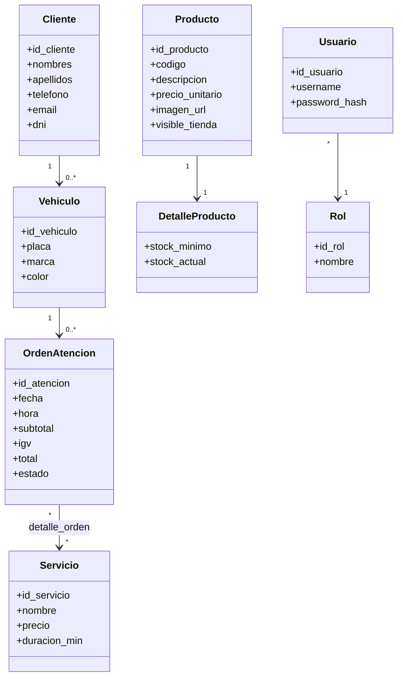
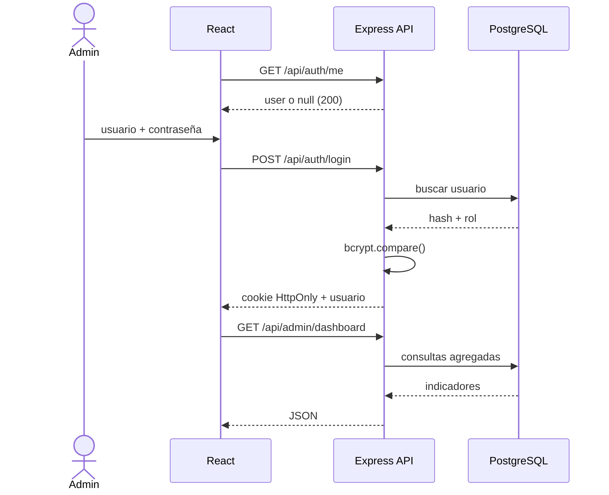
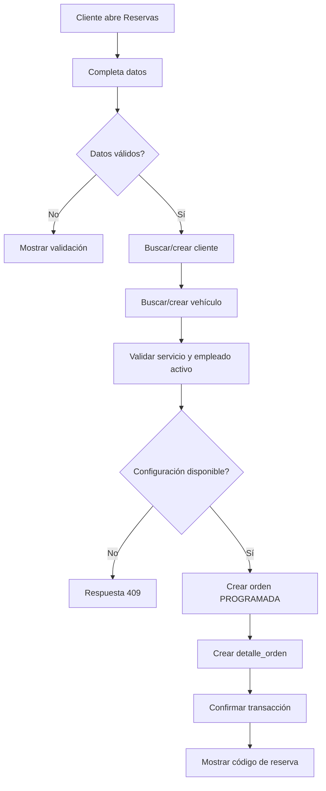
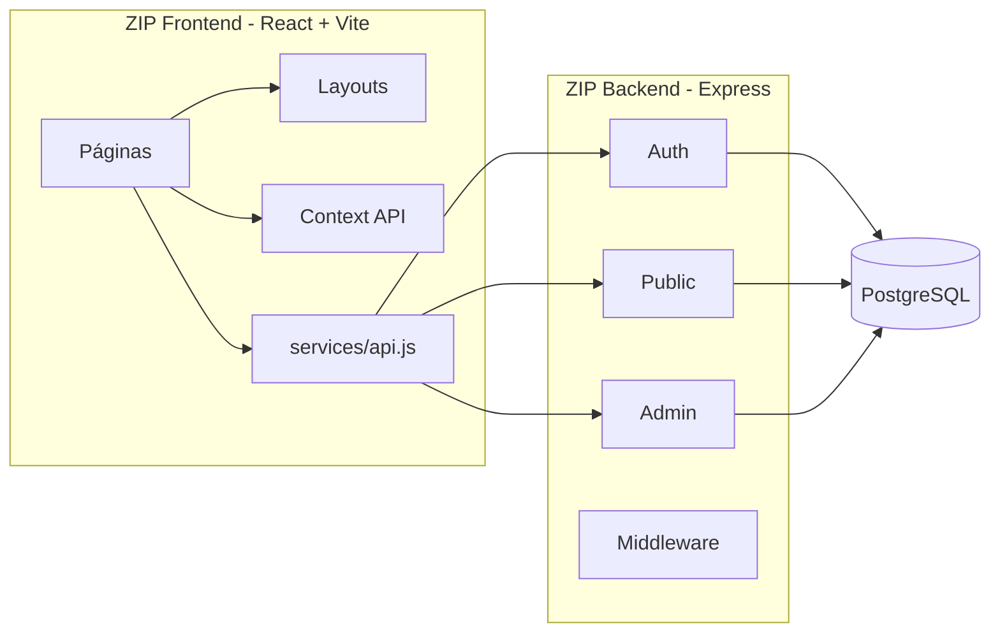
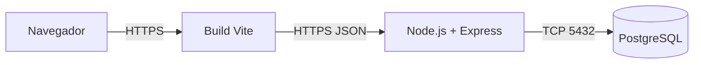

# UML y modelado — Semana 10

## Diagrama de clases / entidades principales

## Diagrama de secuencia — inicio de sesión

## Diagrama de actividad — reserva pública

## Diagrama de componentes

## Diagrama de despliegue

